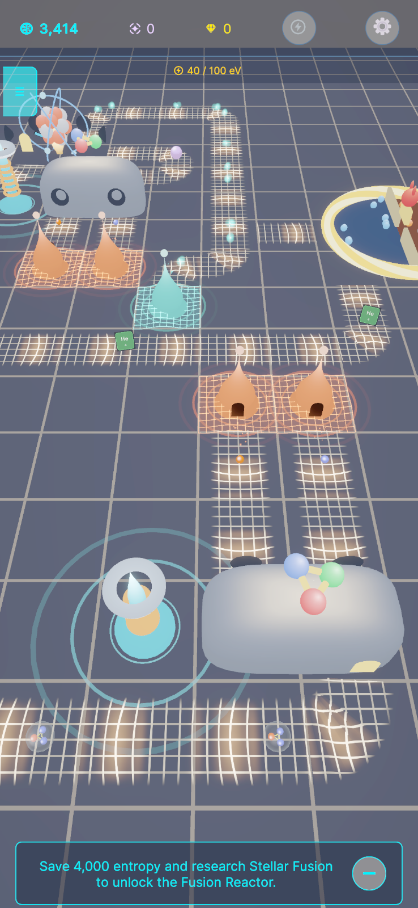
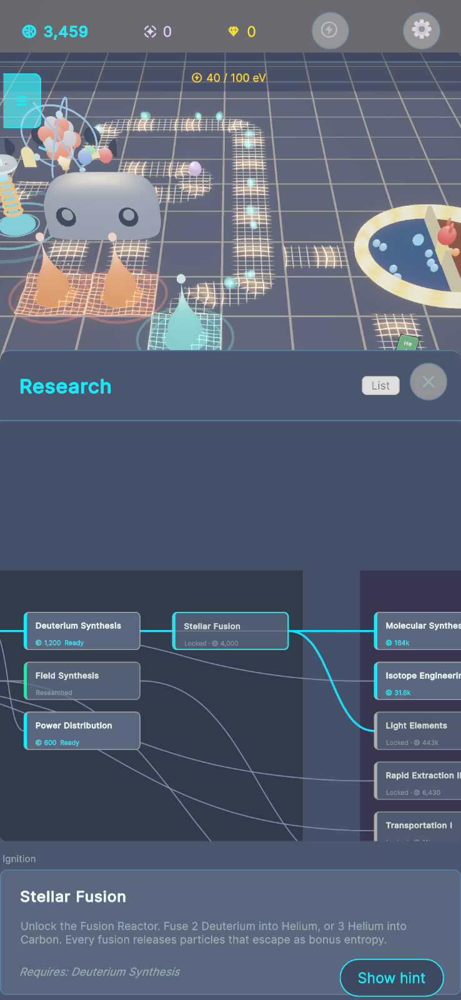
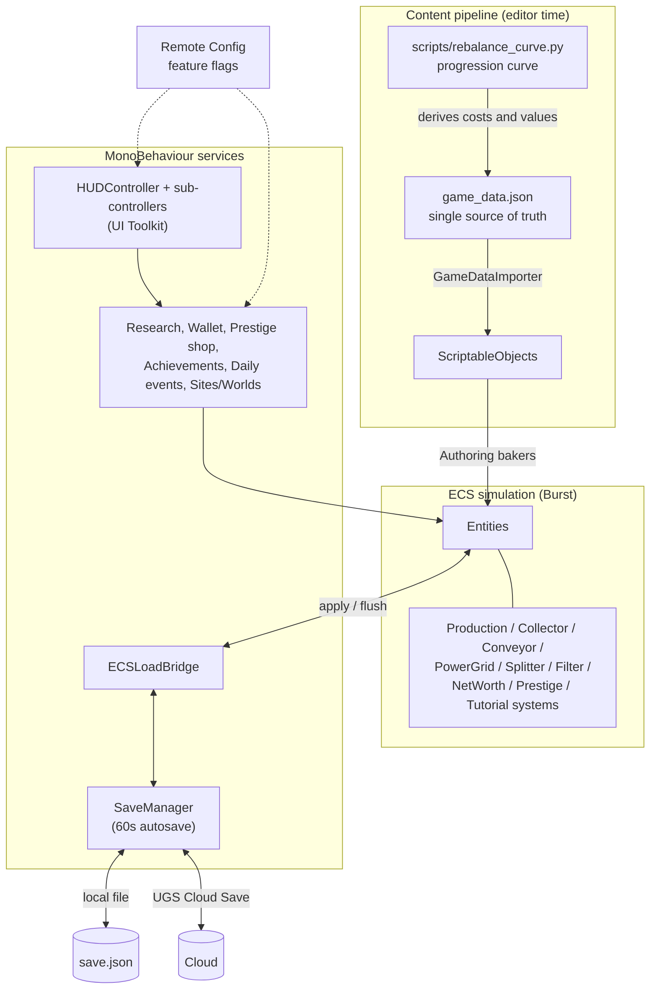

<div align="center">

# Mobile Idle Builder

**An idle factory game where you build matter itself, from quarks and electrons to atoms, molecules and a Dyson Sphere.**


<p>
  
  &nbsp;&nbsp;
  
</p>

</div>

Mobile Idle Builder is a mobile idle/automation game, built solo in Unity with the Data-Oriented Technology Stack (DOTS/ECS). You start with a handful of subatomic particles, harvest them from quantum fields, and wire up harvesters, belts and machines that turn quarks into nucleons, nucleons into elements through fusion and decay chains, and elements into molecules. Every building is "physics made visible": its shape shows the process it performs. The game keeps producing while you're away, and prestige resets trade a run for permanent upgrades.

It's in closed testing on Google Play's internal track and TestFlight (release 0.5).

## Contents

- [Features](#features)
- [Tech stack](#tech-stack)
- [Architecture](#architecture)
- [Engineering highlights](#engineering-highlights)
- [AI-assisted development](#ai-assisted-development)
- [Repository layout](#repository-layout)
- [Getting started](#getting-started)
- [Documentation](#documentation)
- [Status and roadmap](#status-and-roadmap)
- [License](#license)

## Features

- **Grid-based automation**: place harvesters on quantum fields, then draw belts with a router that explains why a path is refused. Belt Splitters, Filters and a proximity power grid with relays handle routing and power.
- **Real science as the tech tree**: 186 items and 199 recipes across 48 research nodes. Physics, Chemistry and Biology are separate worlds, each with its own maps.
- **Idle and offline progress**: an idle snapshot of the factory's flow graph pays out while the app is closed, capped so players come back to collect.
- **Prestige loop**: net-worth-based prestige currency, a 12-upgrade permanent shop, and a Dyson Sphere megastructure as the endgame project.
- **Retention systems**: a 28-day login calendar, daily challenges, achievements in daily, weekly, monthly and progression categories, and building managers with star tiers.
- **A minigame**: the Cyclotron Kick. Tap as a particle crosses the accelerator gap to build energy, which pays out as a timed entropy boost plus Insight for its upgrades.
- **Live-ops ready**: cloud save across Android and iOS, Remote Config feature flags and kill-switches, a maintenance mode, a forced-update prompt, analytics, crash reporting, rewarded ads and IAP.
- **84-step tutorial**: data-driven dialogue and research gates, designed to take a new player to their first Carbon atom in 45-60 minutes.

## Tech stack

| Area | Choice |
|---|---|
| Engine | Unity 6 (6000.3), URP |
| Simulation | DOTS: Entities 1.4, Burst-compiled `ISystem`s, baked SubScene authoring |
| UI | UI Toolkit (UXML/USS), one HUD document with sub-controllers |
| Backend | Unity Gaming Services: Authentication, Cloud Save, Remote Config, Analytics, Cloud Diagnostics |
| Monetization | Unity IAP (Google Play Billing), Unity LevelPlay rewarded ads |
| Sign-in | Google Play Games / Google Sign-In, with UGS session-token reuse |
| Tests | Unity Test Framework (NUnit): EditMode logic and ECS-world tests, plus PlayMode integration tests |
| Tooling | Python (uv) for economy generation, balance and pacing reports, and icon and music pipelines; Blender for 3D molecule icons; PowerShell build and test scripts |
| CI/CD | GitHub Actions on a self-hosted Windows runner for tests and signed builds (Play internal track, TestFlight). Paused for now; see [docs/runbooks/ci-setup.md](docs/runbooks/ci-setup.md). |

## Architecture

The game is one gameplay scene. Simulation runs entirely in ECS. MonoBehaviour services own persistence, platform services and UI, and a single bridge moves state between the two worlds.



Boot runs `SplashScene` (auth, cloud reconciliation, maintenance and update checks), then `LoadingScreen`, then `GameScene`. The detailed map lives in [docs/agents/architecture.md](docs/agents/architecture.md), and the major decisions are recorded as ADRs in [docs/adr/](docs/adr/).

## Engineering highlights

- **Data-driven content.** Every item, recipe, building, research node, dialogue line and tutorial step lives in [`Assets/Data/game_data.json`](Assets/Data/game_data.json). An editor importer generates the ScriptableObjects, so designers never hand-edit `.asset` files. ([ADR 0003](docs/adr/0003-json-single-source-of-truth.md))
- **A derived economy.** Item values and research costs aren't tuned one by one. They're generated by [`scripts/rebalance_curve.py`](scripts/rebalance_curve.py) from a progression curve with target hours per game phase. The script also produces interactive curve and prestige-pacing reports. ([ADR 0004](docs/adr/0004-derived-economy.md))
- **Belt simulation at scale.** Belts carry an ordered item buffer with fixed spacing and move tails first, carrying overshoot between ticks. Inputs follow per-item caps and full-input autosell. The same flow graph is analysed offline for idle earnings.
- **Save integrity.** A load can race the first autosave, which once wiped player progress. `ECSLoadBridge` now gates every flush on a confirmed load (`SaveApplied`). Saves reconcile local and cloud copies, and one save follows the player across Android and iPhone.
- **Operational safety.** Remote Config flags (remote, then cache, then default) back kill-switches for ads, IAP, analytics and the shop. There's also a maintenance mode with a mid-session watcher and a minimum-version update prompt. A testable `GameClock` drives every player-facing timer.
- **Tests as the safety net.** 1,700+ automated tests cover production, belts, power, prestige maths, save round-trips, offline earnings, tutorial gating, achievements, ads and IAP policies. The full suite runs before every commit (`scripts/test-local.ps1`), a git hook stamps a new build version on each commit, and `scripts/pre-commit-check.ps1` blocks known script pitfalls.
- **Supply-chain hygiene.** Every action in the workflows is pinned to a commit SHA with least-privilege permissions. Self-hosted jobs refuse fork PRs, and secrets never touch the repo (secret scanning with push protection, Dependabot, CodeQL).

## AI-assisted development

This project doubles as an experiment in running a real codebase with AI coding agents (Claude Code), with engineering discipline around them:

- **Agent context pack** ([`docs/agents/`](docs/agents/README.md)): layered docs (architecture map, ECS patterns, save system, UI Toolkit, economy) with a routing table. A session reads only what its task needs, and each doc carries a "verified against" commit stamp. A PR that changes a system must update its doc.
- **Spec-first tasks** ([`docs/agents/tasks/`](docs/agents/tasks/)): each feature starts as a written spec with required reading and acceptance criteria. A cheaper model implements it, and a stronger model reviews, runs the suite and merges. Finished specs are archived as a design record.
- **AI playtests** ([`Playtests/`](Playtests/README.md)): an agent plays the game in the Unity Editor through MCP tools (`playtest_state`, `playtest_input`, `playtest_screenshot`, a controllable clock), following persona briefs such as first session, casual idler and whale speed-run. It reports softlocks, unclear goals and pacing walls. Findings become issues and then regression tests.
- **Guardrails** ([`CLAUDE.md`](CLAUDE.md)): project rules learned from real bugs. Examples: always call `base.Awake()`, never read ECS singletons before the load bridge is ready, and grep which UXML is loaded at runtime before editing.

## Repository layout

```
Assets/
  Scripts/
    Systems/          ECS systems (production, conveyors, power, prestige, tutorial...)
    Components/       ECS components and singletons
    Authoring/        SubScene bakers: ScriptableObjects to entities
    Services/         MonoBehaviour/static services (wallet, research, shop, ads, IAP, sites/worlds)
    SaveSystem/       SaveManager, ECSLoadBridge, grid save, cloud reconciliation
    UI/               HUDController and panel sub-controllers (UI Toolkit)
    Grid/ Gameplay/   placement, belt routing, ports, filters, splitters
    IdleCollection/   offline-earnings analysis
    Tests/            EditMode tests
    PlayModeTests/    integration tests
    Editor/           game-data importer, editor windows, MCP playtest tools
  Data/game_data.json single source of truth for all content
  UI/                 GameHUD.uxml / .uss
docs/
  agents/             architecture and subsystem deep-dives (agent context pack)
  adr/                architecture decision records
  runbooks/           CI/CD, IAP, ads and crash-reporting setup
  balance/ analytics/ testing/   balance reports, telemetry dashboard, test checklists
Playtests/            AI playtest briefs, fixtures and reports
scripts/              build, test, economy and asset-pipeline tooling
.github/workflows/    CI/CD (paused)
```

## Getting started

**Requirements:** Unity **6000.3.6f1** with Android and/or iOS build support. Optionally, Python 3 with [uv](https://docs.astral.sh/uv/) for the tooling scripts.

```powershell
git clone https://github.com/aclemetson/mobile-idle-builder.git
cd mobile-idle-builder
```

1. Open the folder in Unity Hub with 6000.3.6f1. The first import takes several minutes.
2. Open `Assets/Scenes/SplashScene.unity` and press Play. Cloud save, Remote Config and analytics need a linked Unity Cloud project. Without one, the game uses its local save and the default value of every feature flag, and the Editor uses a mock ad provider.
3. Run the tests from **Window > General > Test Runner**, or headless with the Editor closed:

```powershell
.\scripts\test-local.ps1 -TestPlatform editmode
```

To change content, edit `Assets/Data/game_data.json`, then run **MobileIdleBuilder > Import Game Data** in the Editor. See [docs/agents/data-pipeline.md](docs/agents/data-pipeline.md).

Signing keys, the Google Play service account, UGS project credentials and `google-services.json` are deliberately not in the repository.

## Documentation

| Doc | What's in it |
|---|---|
| [docs/README.md](docs/README.md) | Index of all documentation |
| [docs/agents/architecture.md](docs/agents/architecture.md) | Scenes, layers, data flow, init order |
| [docs/adr/](docs/adr/) | Why DOTS, why UGS, the JSON pipeline, the derived economy, the single-scene flow |
| [docs/agents/economy-balance.md](docs/agents/economy-balance.md) | Currencies, formulas, progression gates |
| [docs/runbooks/](docs/runbooks/) | CI/CD, IAP, rewarded ads, crash reporting |
| [CHANGELOG.md](CHANGELOG.md) | Release history |

## Status and roadmap

- **0.5 (current):** post-Carbon pacing, Cyclotron Kick, 3D belt particles, belt density and speed research, cross-device save, forced-update prompt, and a derived economy.
- **Next:** economy re-tier for the Chemistry and Biology worlds, more on-device polish from the Alpha 2 test, then open testing.

Planned work is tracked in [Issues](https://github.com/aclemetson/mobile-idle-builder/issues) and milestones.

## License

This repository is **source-available, all rights reserved.** You're welcome to read, clone and run it to evaluate the work. Copying, redistribution and publishing are not permitted. See [LICENSE](LICENSE). Third-party packages and plugins keep their own licenses.
